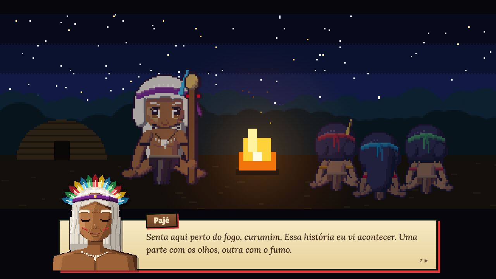
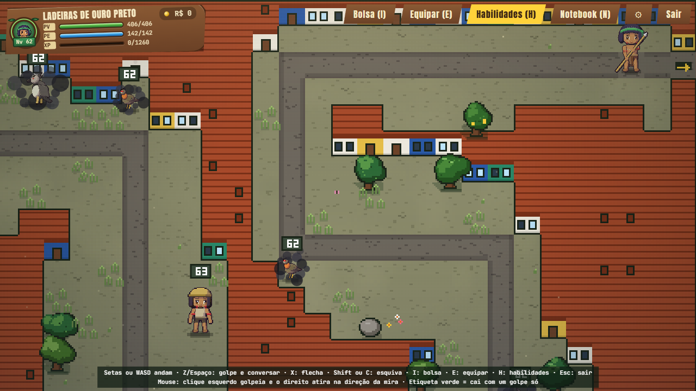
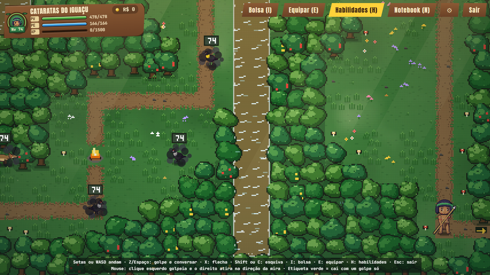

[Português](README.md) · **English**

# Jaci: The Fading Moon (alpha 0.95.0)

*Jaci: A Lua que se Apaga* · a Rhanon Macley adventure · turn-based RPG in the browser

### ▶ [Play in your browser](https://ganseblumchen97.github.io/rhanon-macley/)

Runs in a desktop browser, with keyboard, mouse or gamepad. Nothing to install. The game is available in English:
pick the language in Options.

## Prologue

> *Sit here by the fire, curumim. I saw this story happen. Part of it with my eyes, part of it with the smoke.*
>
> *It was back when Jaci, the moon, began to fade. A gray smoke rose from far away and made the animals angry.*
>
> *Rhanon was a boy from our village. Spear in hand and a head full of computers. He and Franciscane had been together since they were little.*
>
> — the Pajé (the village shaman), who narrates the game

Rhanon and Franciscane are a young Indigenous couple from the Jasytatá village, on the banks of the Tapajós River in the
Amazon. One of them already landed a programming job in Curitiba and sent the other an ad for an opening. At the start
you choose who travels; the other waits in Curitiba and writes letters along the way. Crossing Brazil, the traveler finds out that the smoke from wildfires and cities has taken
shape: **Pytuna, the Moonless Night**, who is putting out Jaci. The animals and the *encantados* (enchanted beings of
Brazilian folklore) of each place have been driven wild by the smoke, and only the village spear can calm them down. Here **nobody
dies**: every animal you beat comes back to itself, thanks you and runs back into the woods.

## The game

- **Free exploration** from a top-down view: walk through the forest, along the river, up the city's steep streets.
  Strike with your spear, shoot arrows, roll to dodge and find secret nooks that only open with the right element.
- **Turn-based battles** in the spirit of classic Pokémon, but with **timing**: press the button as the ring closes to
  land a solid hit or block the animal's attack. Learn the **Forest Fury** and four good timings in a row turn your
  spear into a three-strike combo.
- **Five elements** (fire, water, wind, lightning and plant). Each animal's weakness only shows up once you discover it:
  hit it and you get "One more!".
- **Day and night, rain and fog.** At night the forest changes: different, stronger animals, and the bosses become
  creatures from Brazilian folklore (Curupira, Boitatá, the Headless Mule, Saci...).
- **Bosses that become allies**, talismans the Pajé crafts from their moonlight, and a skill web with three paths
  (Warrior, Tracker and Shaman).
- **Real programming in the story:** fix Rhanon's laptop and take freelance gigs along the way. The jobs arrive by
  e-mail, bugs turn into battles inside the code, and every program you deliver changes something in the game.

## The journey

Rhanon crosses Brazil region by region, by riverboat, bus and plane. Every city has its calm stage (a market, a fair,
a square) and trails full of local animals and legends.

| | |
|---|---|
|  **North:** the village, the forest, the river and Belém |  **Belém:** the Ver-o-Peso market and the city |
|  **At night**, only Rhanon's light and the campfires |  **Center-West:** the Pantanal, Chapada, Bonito and Brasília |
|  **Southeast:** Belo Horizonte, Ouro Preto, Rio and São Paulo |  **South:** the Pampa, Florianópolis, Foz do Iguaçu and Curitiba |
|  **Night boss:** the Boitatá, a fire serpent |  **The map of Brazil** |

The whole journey is playable, from the North to the South: five regions, seventeen stops and the ending in Curitiba,
with the last araucaria forest, Pytuna himself and the job interview. Characters and animals are painted pixel by
pixel, with volume and shading, and battles have their own scenes: the opening, the boss encounter and Pytuna taking
over the last boss of each city.

## Soundtrack

All the music is made by the game itself, in real time, with no audio files. Every region and every character has a
**fixed theme (leitmotif)**: the same melody comes back in different arrangements, in the city, in battle, against a
boss, so it sticks in your head and tells the story through sound. The idea came from Toby Fox's work on Deltarune.

It sounds like the 16-bit consoles with a modern mix: FM bass and brass as on the Mega Drive, the muffled echo of the
Super Nintendo, and Brazilian instruments (berimbau, viola, guitar, accordion, flute) built by physical modeling. If you
prefer the simpler classic soundtrack, pick it in Options.

### 🎧 [Listen to the soundtrack in your browser](https://ganseblumchen97.github.io/rhanon-macley/trilha.en.html)

Eight tracks with a player (the page is in Portuguese): the themes of Rhanon, Pytuna and Jaci, the northern forest
battle, the *bumba-meu-boi* of São Luís, the country *toada* of Cuiabá, the *sertanejo* of Minas Gerais and the boss
music.

## Controls

| | Keyboard | Gamepad |
|---|---|---|
| Move / choose | arrows or WASD | stick or d-pad |
| Strike, talk, confirm | Z or Space | A |
| Arrow, back | X | B |
| Dodge | Shift or C | X |
| Bag · Equipment · Skills · Laptop | I · E · H · N | |

With the mouse, your aim follows the cursor: left button strikes, right button shoots.

## Inspirations

- **Pokémon** (Game Boy Advance): turn-based battles, top-down exploration and the urge to meet every creature.
- **Persona 3, 4 and 5**: the look of the screens and menus, the battle intro cut-in and the "One more!" on a weakness.
- **Deltarune**, by Toby Fox: music themes that return in different arrangements, and an adventure where you never
  really have to defeat anyone.
- **Paper Mario and Mario & Luigi**: pressing at the right time while attacking and defending.
- Top-down **Zelda**: the spear, the arrows and the dodge roll while exploring.

## More

- What changed in each version: [NOVIDADES.md](NOVIDADES.md) (in Portuguese)
- Languages: Portuguese, English, Spanish and French (the translations were made with the help of AI).
- This is an alpha, still in development: ideas, bug reports and opinions are very welcome.
