# Rhanon Macley — RPG (alfa 0.66.2)

### ▶ [Jogar no navegador](https://ganseblumchen97.github.io/rhanon-macley/)

Roda no navegador do computador, com teclado, mouse ou controle. Não precisa instalar nada.

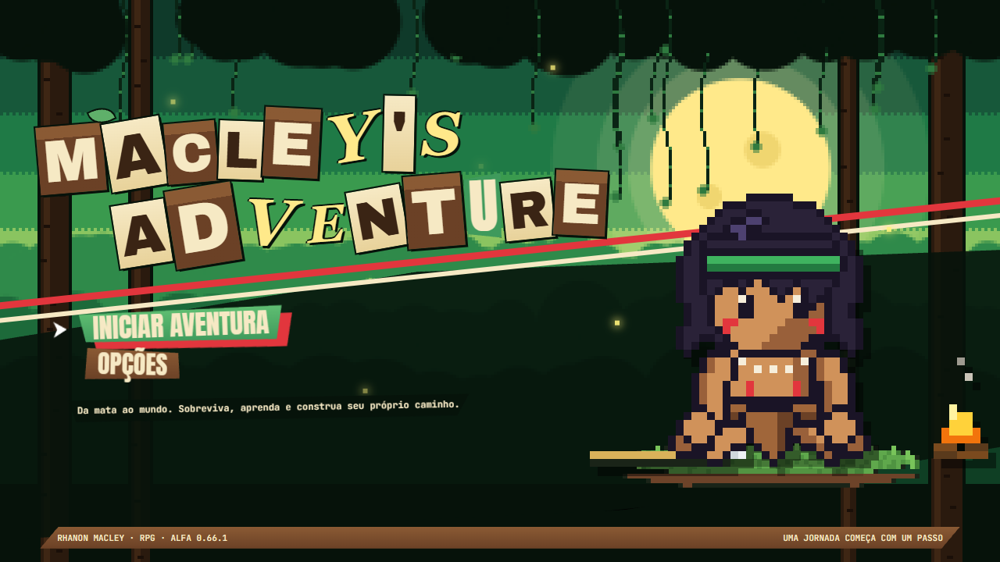

## Prólogo

> *Senta aqui perto do fogo, curumim. Essa história eu vi acontecer. Uma parte com os olhos, outra com o fumo.*
>
> *Foi no tempo em que Jaci, a lua, começou a apagar. Uma fumaça cinza subia de longe e deixava os bichos bravos.*
>
> *O Rhanon era um menino da nossa aldeia. Lança na mão e a cabeça cheia de computador. Sonhava com Curitiba, imagina.*
>
> — o Pajé, que narra o jogo

Rhanon é um jovem indígena da Aldeia Jasytatá, na beira do Tapajós, que quer trabalhar com programação em Curitiba.
No caminho pelo Brasil, ele descobre que a fumaça das queimadas e das cidades tomou forma: **Pytuna, a Noite sem Lua**,
que está apagando Jaci. Os bichos e os encantados de cada lugar ficaram bravos com a fumaça, e só o Rhanon consegue
acalmá-los. Aqui **ninguém morre**: cada bicho vencido volta a si, agradece e corre para o mato.

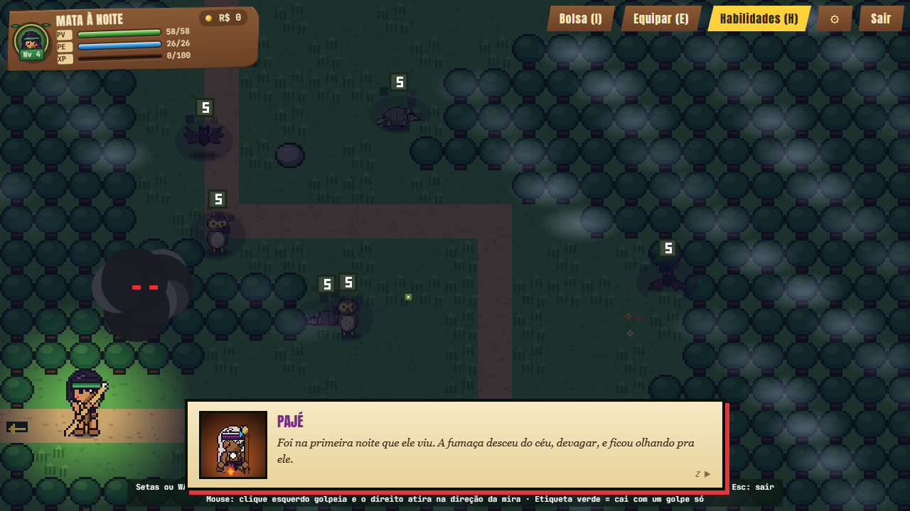

## Como é o jogo

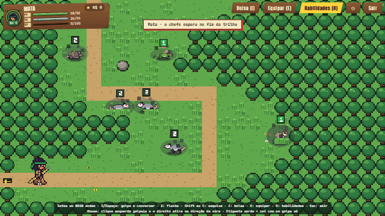

- **Exploração livre** vista de cima: ande pela mata, pela beira do rio, pelas ladeiras da cidade. Golpeie com a lança,
  atire flecha, role para desviar e encontre recantos secretos que só abrem com o elemento certo.
- **Batalha por turno**, no espírito do Pokémon antigo, mas com **tempo certo**: aperte no momento em que o anel fecha
  para acertar em cheio ou bloquear o golpe do bicho. Três acertos seguidos enchem a **Fúria da mata**.
- **Cinco elementos** (fogo, água, vento, raio e planta). A fraqueza de cada bicho só aparece depois de você descobrir:
  acertou, ganha "Mais uma!".
- **Dia e noite, chuva e neblina.** À noite a mata muda: outros bichos, mais fortes, e os chefes viram encantados do
  folclore (Curupira, Boitatá, Mula sem cabeça, Saci...).
- **Chefes que viram aliados**, talismãs feitos pelo Pajé com o luar deles e três caminhos de habilidade (Guerreiro,
  Rastreador e Pajé).
- **Programação de verdade na história:** conserte o notebook do Rhanon e pegue freelas pelo caminho. Os bugs viram
  lutas dentro do código, e cada programa entregue muda alguma coisa no jogo.

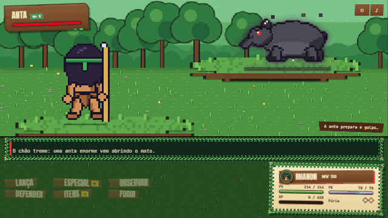

## A viagem

O Rhanon atravessa o Brasil por regiões, de barco, ônibus e avião. Cada cidade tem a sua fase tranquila (feira, mercado,
praça) e trilhas com bichos e lendas de lá.

| | |
|---|---|
| 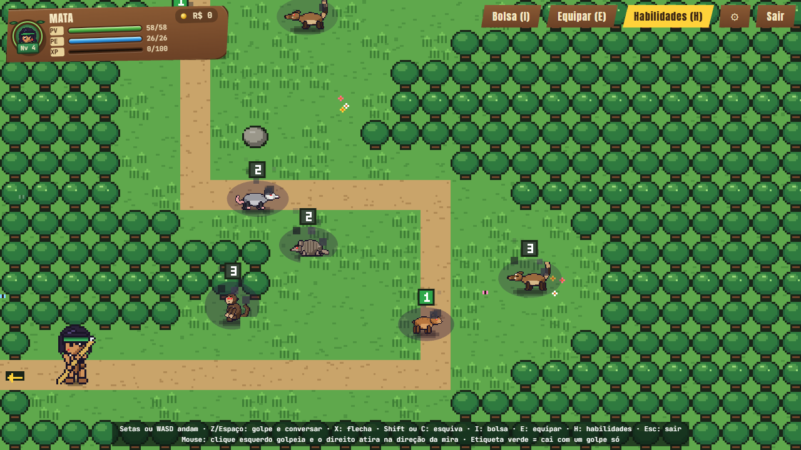 **Norte:** a aldeia, a mata, o rio e Belém | 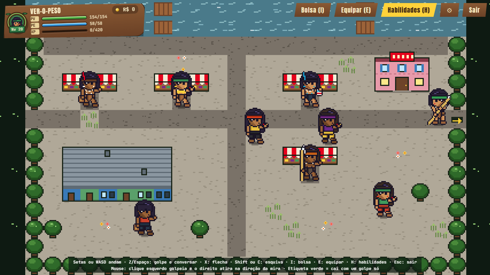 **Belém:** o Ver-o-Peso e a cidade |
| 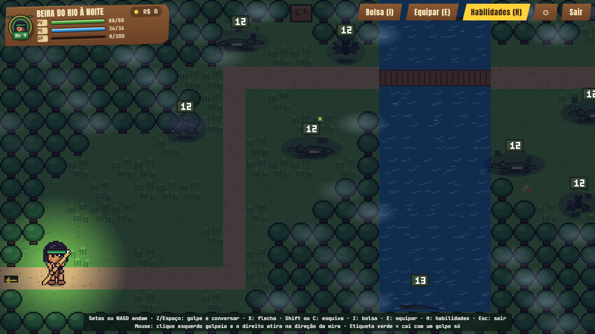 **De noite**, só a luz do Rhanon e das fogueiras | 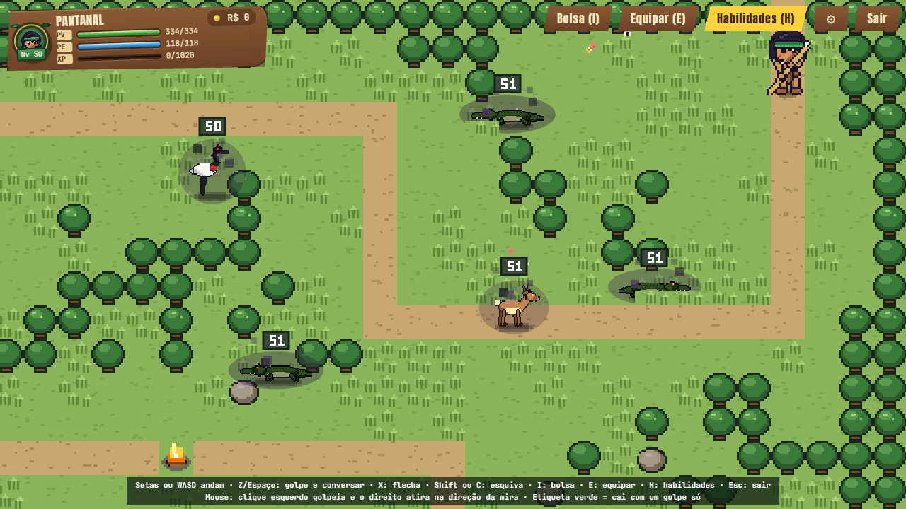 **Centro-Oeste:** o Pantanal, a Chapada, Bonito e Brasília |
| 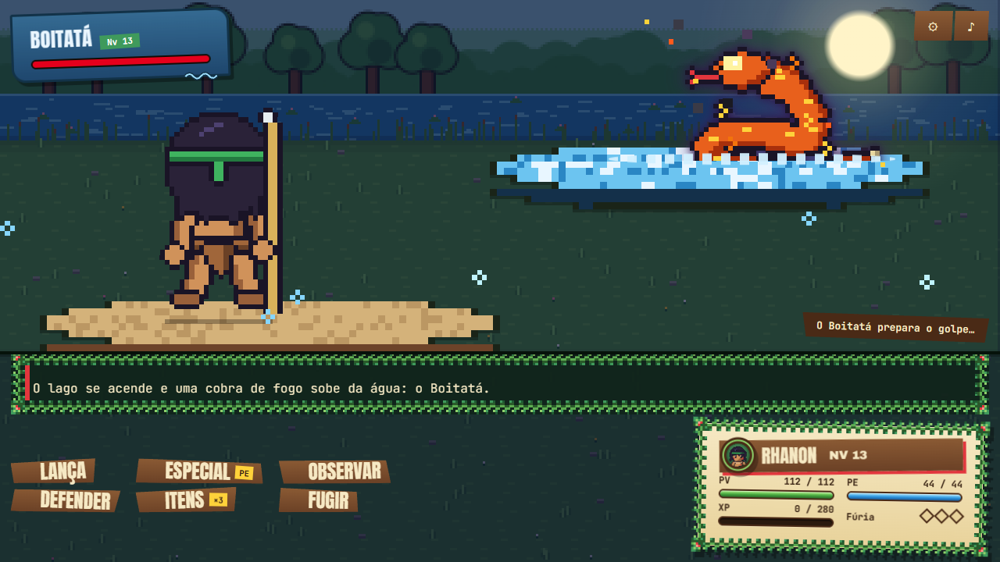 **Chefe da noite:** o Boitatá | 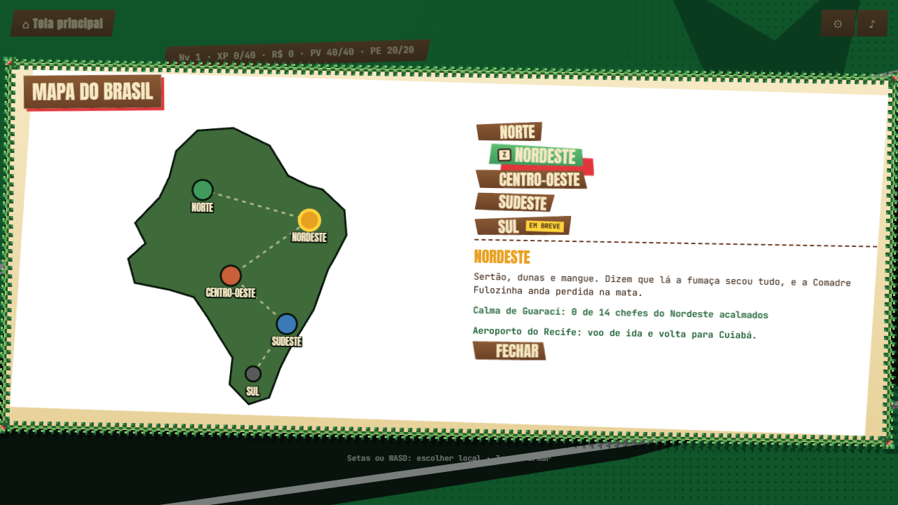 **O mapa do Brasil** |

Prontos: **Norte**, **Nordeste** (São Luís, Teresina, Recife, Petrolina) e **Centro-Oeste**. Em andamento: o **Sudeste**
(Belo Horizonte e Ouro Preto). O **Sul**, com Curitiba e o fim da história, vem depois.

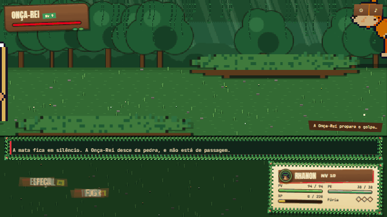

## Trilha sonora

Toda a música é feita pelo próprio jogo, em tempo real, sem arquivos de áudio. Cada região e cada personagem tem um
**tema fixo (leitmotif)**: a mesma melodia volta em arranjos diferentes, na cidade, na batalha, no chefe, para ficar na
cabeça e contar a história pelo som. A ideia veio do trabalho do Toby Fox em Deltarune.

Clique para ouvir (abre no navegador):

- [Tema do Rhanon](midia/tema-rhanon.webm), na tela inicial
- [Norte: batalha na mata](midia/norte-batalha.webm), roda de capoeira
- [Nordeste: São Luís](midia/nordeste.webm), toada de bumba-meu-boi com sanfona
- [Centro-Oeste: Cuiabá](midia/centro-oeste.webm), toada caipira de viola
- [Sudeste: Minas](midia/sudeste-minas.webm), sertanejo universitário
- [Chefe](midia/chefe.webm)
- [Tema de Pytuna](midia/tema-pytuna.webm), o vilão
- [Tema de Jaci](midia/tema-jaci.webm), a lua voltando a brilhar

## Controles

| | Teclado | Controle |
|---|---|---|
| Andar / escolher | setas ou WASD | analógico ou direcional |
| Golpe, conversar, confirmar | Z ou Espaço | A |
| Flecha, voltar | X | B |
| Esquiva | Shift ou C | X |
| Bolsa · Equipamento · Habilidades | I · E · H | |

No mouse, a mira segue o cursor: botão esquerdo golpeia e o direito atira.

## Inspirações

- **Pokémon** (Game Boy Advance): a batalha por turno, a exploração vista de cima e a vontade de conhecer cada bicho.
- **Persona 3, 4 e 5**: o visual das telas e dos menus, a cinemática do começo da luta e o "Mais uma!" na fraqueza.
- **Deltarune**, do Toby Fox: os temas de música que voltam em arranjos diferentes e uma aventura em que não é preciso
  derrotar ninguém de verdade.
- **Paper Mario e Mario & Luigi**: apertar no tempo certo durante o golpe e na defesa.
- **Zelda** vista de cima: a lança, a flecha e o rolamento na exploração.

## Mais

- O que mudou em cada versão: [NOVIDADES.md](NOVIDADES.md)
- Idiomas: português, inglês, espanhol e francês (as traduções foram feitas com ajuda de IA).
- É uma versão alfa, em desenvolvimento: ideias, bugs e opiniões são muito bem-vindos.
